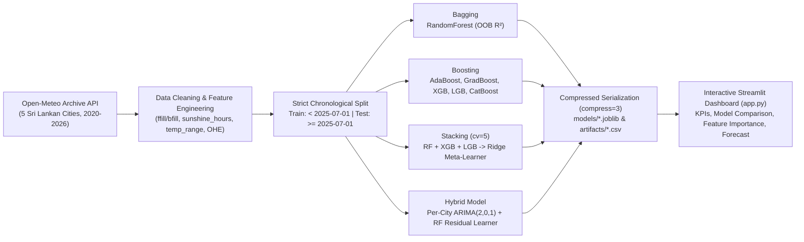

# 🌦️ Sri Lanka Weather Forecasting: Ensemble Learning Dashboard

> ### 🤖 Generative AI Attribution Statement
> **Mandatory Academic Disclosure:**  
> In compliance with academic integrity standards, this project discloses that Generative AI coding assistance (**Antigravity IDE / Google Gemini**) was used for **code scaffolding, Streamlit dashboard UI layout design, and Git/DevOps workflow automation**.  
> All **Sri Lankan meteorological dataset selection, data leakage prevention, model training & execution verification, and domain result interpretations** were independently executed and verified by the student.

---

## 📌 Project Overview
This project builds, evaluates, and deploys an end-to-end **Next-Day Daily Mean Temperature (`target_next_temp`, °C)** forecasting pipeline and interactive **Streamlit Dashboard** tailored specifically to **Sri Lanka's diverse microclimates**.

Using nearly 7 years of daily meteorological observations (`2020-01-01` to `2026-10-31`) fetched from the **Open-Meteo Historical Weather API**, we benchmark **4 distinct Ensemble & Hybrid Model Families** (8 models total):
1. **Bagging:** `RandomForestRegressor` with Out-of-Bag (`oob_score=True`) internal validation.
2. **Boosting:** `AdaBoostRegressor`, `GradientBoostingRegressor`, `XGBRegressor`, `LGBMRegressor`, and `CatBoostRegressor`.
3. **Stacking:** `StackingRegressor` combining heterogeneous Level-0 base models (`RandomForest`, `XGBoost`, `LightGBM`) via 5-fold cross-validation (`cv=5`) into a Level-1 `Ridge` meta-learner.
4. **Hybrid (Time-Series + Tree Ensemble):** Station-specific `ARIMA(2, 0, 1)` fitted strictly on training data to capture linear autoregressive persistence, paired with a `RandomForestRegressor` trained on the non-linear training residuals ($e_t = y_{\text{train}, t} - \hat{y}_{\text{ARMA}, t}$).

---

## 🇱🇰 Sri Lankan Meteorological Dataset (`data/sri_lanka_weather.csv`)

Daily observations (`timezone=Asia/Colombo`) across **5 representative Sri Lankan cities** spanning distinct climatic and elevational zones:

| City | Climate Zone | Coordinates | Elevation | Key Climatological Characteristics |
| :--- | :--- | :--- | :--- | :--- |
| **Colombo** | Wet Zone (Western Coastal) | `6.9271° N, 79.8612° E` | ~7 m | Heavy Southwest Monsoon (*Yala*) & Inter-Monsoon rainfall; high coastal thermal stability |
| **Kandy** | Wet / Intermediate Zone (Central Hills) | `7.2906° N, 80.6337° E` | ~500 m | Hill-country basin; moderate diurnal temperature swings |
| **Galle** | Wet Zone (Southern Coastal) | `6.0535° N, 80.2210° E` | ~12 m | Strong maritime winds and year-round coastal humidity |
| **Jaffna** | Dry / Arid Zone (Northern Peninsula) | `9.6615° N, 80.0255° E` | ~5 m | High solar radiation, hot dry summers, rain concentrated in Northeast Monsoon (*Maha*) |
| **Nuwara Eliya** | Montane Wet Zone (Central Highlands) | `6.9497° N, 80.7891° E` | ~1,868 m | Sub-tropical highland regime ($14^\circ\text{C} - 17^\circ\text{C}$ mean), steep adiabatic cooling |

- **Raw Daily Variables:** `temperature_2m_max`, `temperature_2m_min`, `temperature_2m_mean`, `precipitation_sum`, `wind_speed_10m_max`, `sunshine_duration`
- **Engineered Features:** `sunshine_hours` (`sunshine_duration / 3600`), `month`, `day_of_year`, `temp_range` (`max - min`), and one-hot encoded city indicators (`city_Colombo`, `city_Galle`, `city_Jaffna`, `city_Kandy`, `city_Nuwara Eliya`).
- **Target Variable:** `target_next_temp` (next day's mean temperature per city via `shift(-1)`).
- **Strict Chronological Split (Zero Data Leakage):**
  - **Training Set:** `< 2025-07-01` ($10,020$ city-day rows)
  - **Testing Set:** `>= 2025-07-01` ($2,435$ city-day rows)

---

## 🏗️ System Architecture



---

## 📊 Final Model Comparison Results (Test Set `>= 2025-07-01`)

- **Bagging Random Forest Out-of-Bag ($R^2_{\text{OOB}}$) Score:** `0.9875`

| Rank | Model Family | RMSE (°C) | MAE (°C) | $R^2$ Score |
| :---: | :--- | :---: | :---: | :---: |
| **1** | **Hybrid: ARMA + Random Forest** | **0.5477** | **0.4200** | **0.9860** |
| **2** | **Stacking (RF+XGB+LGB -> Ridge)** | **0.5636** | **0.4346** | **0.9852** |
| **3** | **Boosting: Gradient Boosting** | **0.5639** | **0.4338** | **0.9852** |
| **4** | **Boosting: LightGBM** | **0.5674** | **0.4384** | **0.9850** |
| **5** | **Boosting: XGBoost** | **0.5700** | **0.4384** | **0.9848** |
| **6** | **Bagging: Random Forest** | **0.5704** | **0.4419** | **0.9848** |
| **7** | **Boosting: CatBoost** | **0.5783** | **0.4451** | **0.9844** |
| **8** | **Boosting: AdaBoost** | **0.6331** | **0.4935** | **0.9813** |

---

## 📂 Repository Structure

```text
├── SriLanka_Weather_Ensemble.ipynb   # Executed end-to-end Jupyter Notebook with outputs & charts
├── app.py                            # Interactive Streamlit Ensemble Learning Dashboard
├── requirements.txt                  # Python dependencies for local & Streamlit Cloud deployment
├── README.md                         # Project documentation & GenAI attribution statement
├── .gitignore                        # Tracks data/, models/, and artifacts/; ignores .venv/ & caches
├── data/
│   └── sri_lanka_weather.csv         # Raw daily Sri Lankan weather observations (2020-2026)
├── models/                           # Compressed joblib models (every file < 50 MB)
│   ├── ensemble_models.joblib
│   ├── arma_models.joblib
│   ├── hybrid_rf_residual.joblib
│   ├── feature_cols.joblib
│   └── recent_city_temps.joblib
└── artifacts/                        # Evaluation metrics, feature importances & test forecasts
    ├── model_results.csv
    ├── feature_importance.csv
    └── colombo_forecast_sample.csv
```

---

## 🚀 How to Run Locally

```bash
# 1. Create and activate a virtual environment
python -m venv .venv
# Windows PowerShell:
.\.venv\Scripts\Activate.ps1
# macOS / Linux:
# source .venv/bin/activate

# 2. Install dependencies
pip install -r requirements.txt

# 3. Launch the Streamlit Dashboard
streamlit run app.py
```

---

## ☁️ Deploying on Streamlit Community Cloud (`https://share.streamlit.io`)

1. Go to [share.streamlit.io](https://share.streamlit.io) and click **"Create app"** (or **"New app"**).
2. Select your GitHub repository (`Tishanth-07/srilanka-weather-dashboard`), branch `main`, and set **Main file path** to `app.py`.
3. Click **"Deploy!"** — Streamlit Cloud will automatically install `requirements.txt` and load the pre-trained `.joblib` models and `.csv` artifacts.
